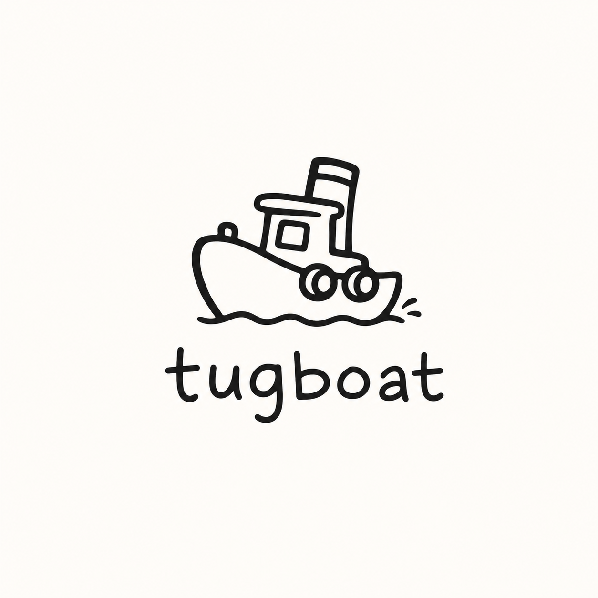
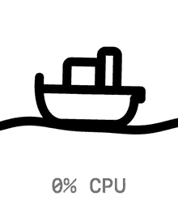

<p align="center">
  
</p>

<h1 align="center">Tugboat</h1>

<p align="center">
  <em>What is that thing on port 3000?</em><br>
  A macOS menubar app that answers, in English, for every port on your machine.
</p>

<p align="center">
  
  
  
</p>

---

<!-- DEMO: drop demo-panel.gif into assets/ and uncomment.
<p align="center">
  
</p>
-->

## The problem

`lsof` knows everything except the only thing you wanted:

```
COMMAND     PID USER   FD   TYPE   NODE NAME
figma_age   942   bp    9u  IPv4    TCP 127.0.0.1:44950 (LISTEN)
figma_age   942   bp   10u  IPv4    TCP 127.0.0.1:44960 (LISTEN)
logioptio   911   bp   53u  IPv4    TCP *:59869 (LISTEN)
rapportd    713   bp    3u  IPv4    TCP *:59899 (LISTEN)
node       4311   bp   21u  IPv6    TCP *:4311 (LISTEN)
```

Which of those is safe to kill? You can't tell. So the tab stays open, the
process stays running, and six months later you have twenty servers listening
and no idea what any of them are.

Tugboat says it out loud:

> **rapportd (Apple Handoff)** · `:59899`
> A built-in Mac feature that lets your phone and other Apple devices talk to
> this computer — Handoff, Universal Clipboard. Part of macOS; it'll just start
> again if you close it. **Not safe to kill.**

> **Vendor app (dev)** · `:4311`
> A local copy of the vendor site your team is working on, running so it can be
> previewed. Closing it just means you'd start it again. **Safe to kill.**

That gap — between what a port *is* and what you're allowed to *do* about it —
is the entire product.

## How it works

**Scan.** Every 4 seconds: `lsof` for the listening set, one batched `ps` for
pid, argv, cwd, memory, CPU and uptime, plus a live connection count. One pass,
no per-process shelling.

**Enrich, deterministically first.** Before any model sees a row, Tugboat reads
the actual evidence — `package.json` name, git remote, the argv, the working
directory. Most rows are half-identified by facts alone.

**Describe.** What's left goes to a model once, and the answer is cached to disk
against a *fingerprint of the process*, not the port — so a dev server that
comes back on a different port is still recognised. You pay for each thing once,
ever.

**Group.** A second pass over the whole board, because a per-port view
structurally cannot see that five ports are one monorepo. Only comparing them
can.

**Act.** Open in browser, re-ask what something is, or quit it. Nothing is ever
killed without a second click.

<!-- DEMO: drop demo-reask.gif into assets/ and uncomment.
<p align="center">
  
</p>
-->

## The icon knows before you do


The menubar icon is a tugboat on the water, drawn frame by frame — the sea is
two sine waves beating against each other, and the boat samples the wave it's
floating on, so it rises with the crests and leans down the slope rather than
sitting on top.

**The sea gets choppier the more CPU your listening processes are using.** A
glance tells you something woke up before you've opened anything.

Mapped non-linearly on purpose: nothing → one busy process is the change worth
seeing; 300% → 400% isn't. Calm water laps at about 2fps and only speeds up when
there's something to say — an app whose whole argument is *here's what's eating
your machine* doesn't get to sit there eating your machine to look cute.

<p align="center">
  
</p>

<p align="center"><sub>
  The same icon at 0%, 25%, 90%, 260% and 600% CPU — rendered by replaying the
  real ticker, so the speed is the speed.
</sub></p>

## Two wordings

Switchable live, from the panel. **simple** explains a port to somebody who
doesn't know what a port is:

> Part of Figma, quietly running in the background so the app works properly;
> closing it just means Figma starts it again next time you need it.

**technical** assumes you do, and spends the sentence on process, parent and
lifecycle instead. Each register is cached separately, so switching costs one
re-ask per row and then never again.

The wording changes. **The safe-to-kill judgement never does** — a simple mode
that is also a more permissive mode is how somebody drops a database.

## Build

No Xcode project. One file, one compiler invocation.

```sh
git clone https://github.com/brb-dreaming/tugboat
cd tugboat
./build.sh     # swiftc -O -o Tugboat Tugboat.swift
./Tugboat
```

**Requirements:** built and run on macOS 26, which gets the Liquid Glass
surface. Below 26 that one surface falls back to a tinted panel and everything
else is identical.

**Descriptions** need the [`claude` CLI](https://claude.com/claude-code) on your
PATH, signed in. Without it the app still runs — rows just fall back to what the
process says about itself. There is **no API key to set and no config file**;
Tugboat reads no environment variables at all. (If you happen to have
`ANTHROPIC_API_KEY` exported, the CLI will use it, and descriptions bill there.)

### Headless

A running SwiftUI app can't be screenshotted from a shell, so the two things
worth verifying have their own doors:

```sh
./Tugboat --scan --describe --group    # print what the menubar would show
./Tugboat --icon /tmp/boat             # dump icon frames to PNG at 8x, at
                                       # loads your machine isn't under
./Tugboat --icon-anim /tmp/boat 0,90,600
                                       # one PNG per tick of the real 12fps
                                       # ticker — the only way to see the SPEED
```

`--simple` / `--technical` override the saved wording for one run.

## Notes

- Cache lives at `~/.claude/ports-cache-v2.json` (descriptions) and
  `~/.claude/ports-groups.json` (grouping). Delete either to force a re-ask.
- Model calls run `--strict-mcp-config --no-session-persistence`: one answer, no
  MCP servers booted, no transcript per description. A default `claude -p` is a
  whole interactive session in miniature, and one per port makes a menubar
  utility the heaviest thing on the machine.
- Sonnet first, Haiku if Sonnet is unreachable, and the row says which answered.
  A model failure is never written to the cache as if it were an answer.
- Grouping is forbidden from inventing abstract business names — groups are
  named after the app or repo they actually are.
