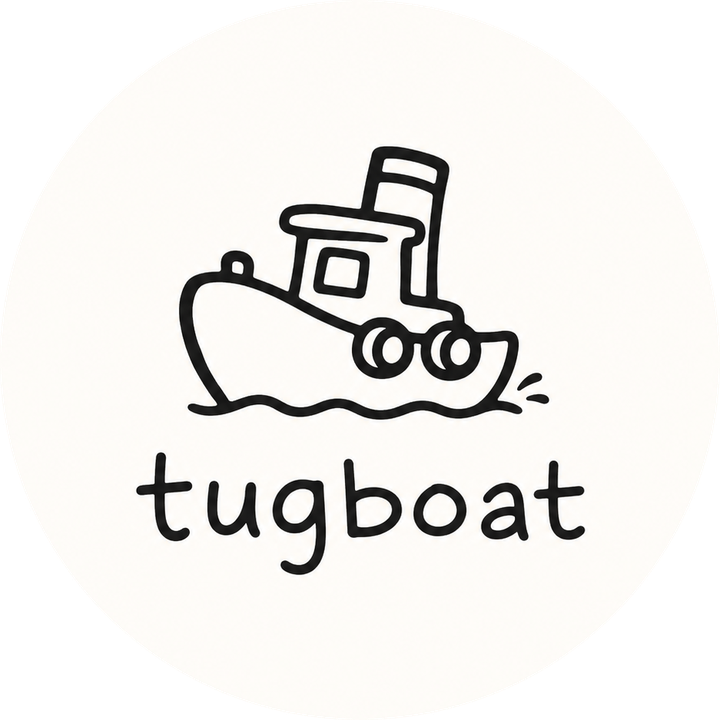

<p align="center">
  
</p>

<h1 align="center">Tugboat</h1>

<p align="center">
  A macOS menubar app that answers, in English, for every port on your machine.
</p>

<p align="center">
  
  
</p>

---

## Know what's on every port

Tugboat reports on every process so that you know what's running and what it is.

<p align="center">
  
</p>

## How it works

**Scan.** Every 4 seconds: `lsof` for the listening set, one batched `ps` for
pid, argv, cwd, memory, CPU and uptime, plus a live connection count. 

**Enrich, deterministically first.** Before any model sees a row, Tugboat reads
the actual evidence — `package.json` name, git remote, the argv, the working
directory. 

**Describe.** What's left goes to a model once, and the answer is cached to disk
against a *fingerprint of the process*, not the port... so a dev server that
comes back on a different port is still recognised. You pay for each thing once,
ever.

**Group.** A second pass over the whole board, because a per-port view
structurally cannot see that five ports are one monorepo. Only comparing them
can.

**Act.** Open in browser, re-ask what something is, or quit it. Nothing is ever
killed without a second click.

**Monitor.** The menubar icon responds to your CPU load.

<p align="center">
  
</p>

## Written for humans

Pick between simple or technical explanations of what's going on in your ports.

## Build

No Xcode project. One file, one compiler invocation.

```sh
git clone https://github.com/brb-dreaming/tugboat
cd tugboat
./build.sh     # swiftc -O -o Tugboat Tugboat.swift
./Tugboat
```

**Requirements:** built and run on macOS 26, which gets the Liquid Glass
surface. Below 26 that one surface falls back to a tinted panel and everything
else is identical.

**Descriptions** need the [`claude` CLI](https://claude.com/claude-code) on your
PATH, signed in. Without it the app still runs — rows just fall back to what the
process says about itself. There is **no API key to set and no config file**;
Tugboat reads no environment variables at all. (If you happen to have
`ANTHROPIC_API_KEY` exported, the CLI will use it, and descriptions bill there.)

**What leaves your machine.** To identify a port, Tugboat sends the model the
port number, the process name, its argv, its working directory, the
`package.json` name and the git origin URL. That's enough to include private
repo names and local paths. It goes through your own `claude` CLI, once per
process, and the answer is cached so it isn't re-sent. Nothing else — no
connection data, no file contents, no telemetry to anyone.

### Headless

```sh
./Tugboat --scan --describe --group    # print what the menubar would show
./Tugboat --icon /tmp/boat             # dump icon frames to PNG at 8x, at
                                       # loads your machine isn't under
./Tugboat --icon-anim /tmp/boat 0,60,200
                                       # one PNG per tick of the real 12fps
                                       # ticker — the only way to see the SPEED
```

`--simple` / `--technical` override the saved wording for one run.

<details>
<summary><b>Setting this up for someone (agent instructions)</b></summary>

<br>

If you are an agent installing Tugboat on a user's Mac, follow this in order.
Read the whole block before you start.

**1. Build.**

```sh
git clone https://github.com/brb-dreaming/tugboat ~/tugboat
cd ~/tugboat && ./build.sh
```

`build.sh` is the only supported invocation. A bare `swiftc Tugboat.swift`
fails — it needs `-framework Cocoa -framework SwiftUI -framework Combine`.
Expect warnings about Sendable closure captures; those are not errors, and the
build succeeded if the last line is `built: …/Tugboat`.

**2. Verify before launching, not after.**

```sh
./Tugboat --scan --describe --group
```

This is the whole pipeline printed to stdout. It is the only way you can check
your own work: Tugboat is a menubar app with no window, so **it will not appear
in a screenshot and `screencapture` will silently grab whatever is frontmost
instead**. Do not report success on the basis of a screenshot. If `--scan`
prints a port table with descriptions, it works.

**3. Check the description path specifically.** In the `--scan` output, each row
ends in a confidence marker like `[high]`. If every row instead reads as bare
process names with no English sentence, the `claude` CLI is missing from PATH or
not signed in — run `claude -p hello` as the user and fix that first. The app
still runs without it; it just degrades to what the process says about itself.

**4. Configure nothing.** There is no config file, no API key, and Tugboat reads
no environment variables. If you find yourself writing a `.env`, you have
misread the setup.

**5. Launch.** `./Tugboat &` — a boat appears at the right end of the menubar.
Click it for the panel.

**6. Only if the user asked for launch-at-login**, write
`~/Library/LaunchAgents/com.brb.tugboat.plist` with an absolute path to the
built binary:

```xml
<dict>
  <key>Label</key>            <string>com.brb.tugboat</string>
  <key>ProgramArguments</key> <array><string>/Users/NAME/tugboat/Tugboat</string></array>
  <key>RunAtLoad</key>        <true/>
  <key>KeepAlive</key>        <false/>
</dict>
```

then `launchctl load ~/Library/LaunchAgents/com.brb.tugboat.plist`. `KeepAlive`
stays false on purpose — if the user quits the boat, it should stay quit.

**Cleanup:** `launchctl unload` the plist if you wrote one, delete
`~/.claude/ports-cache-v2.json` and `~/.claude/ports-groups.json`, remove the
clone. Nothing else on the machine is touched.

</details>

## Notes

- Cache lives at `~/.claude/ports-cache-v2.json` (descriptions) and
  `~/.claude/ports-groups.json` (grouping). Delete either to force a re-ask.
- Model calls run `--strict-mcp-config --no-session-persistence`: one answer, no
  MCP servers booted, no transcript per description. A default `claude -p` is a
  whole interactive session in miniature, and one per port makes a menubar
  utility the heaviest thing on the machine.
- Sonnet first, Haiku if Sonnet is unreachable, and the row says which answered.
  A model failure is never written to the cache as if it were an answer.
- Grouping is forbidden from inventing abstract business names — groups are
  named after the app or repo they actually are.
